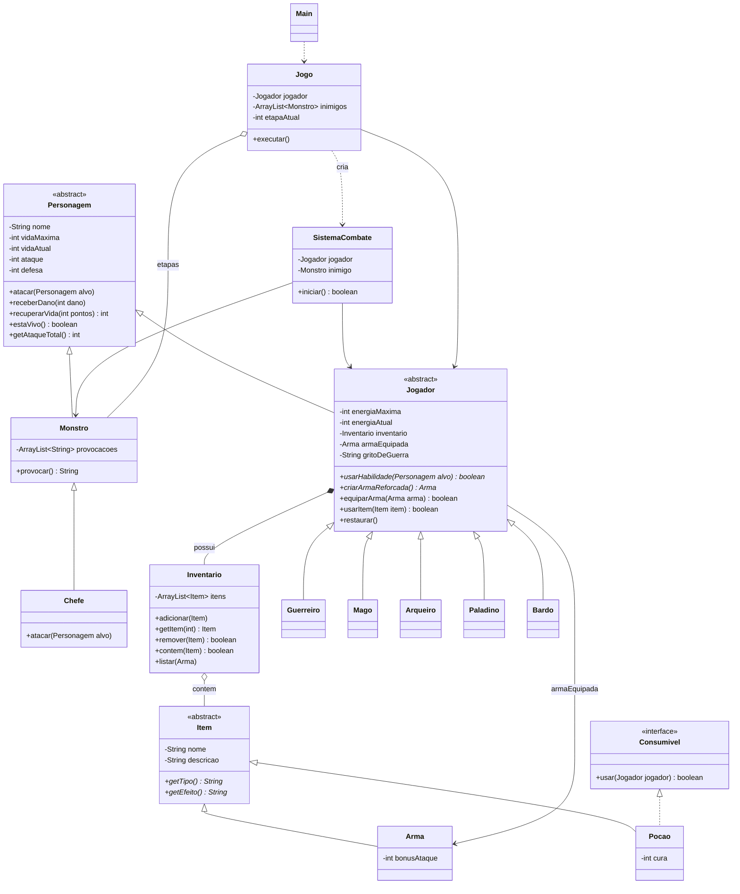

# A Fortaleza do Guardiao — RPG em Java (console)

Projeto final de POO. Um RPG curto de turnos: o jogador cria um personagem, escolhe uma classe e enfrenta
3 batalhas em ordem (Goblin, Esqueleto e o chefe Guardiao da Fortaleza).

## Como executar

Precisa apenas do JDK (versao 11 ou mais nova). Na pasta do projeto:

```bash
javac -d bin $(find src -name "*.java")
```

```bash
java -cp bin rpg.app.Main
```

No Windows (PowerShell), compile com `javac -d bin (Get-ChildItem -Recurse src -Filter *.java).FullName`.

## Como jogar

1. Escolha **Novo jogo**, digite o nome, a classe e um grito de guerra.
2. No menu entre as batalhas: consultar personagem, ver o inventario / trocar arma, ou iniciar a proxima batalha.
3. Em cada turno: **1** ataque comum, **2** habilidade especial (gasta energia), **3** usar item.
4. Recompensas: Pocao de cura apos a 1a batalha e a arma reforcada da sua classe apos a 2a.
   Vida e energia sao restauradas entre as batalhas.

## Classes

| Classe | Vida | Ataque | Defesa | Energia | Arma inicial / reforcada | Habilidade |
|---|---|---|---|---|---|---|
| Guerreiro | 140 | 18 | 8 | 30 | Espada curta / Espada longa | Golpe poderoso (10): `max(1, 2*ataque - defesa)` |
| Mago | 100 | 22 | 4 | 50 | Cajado / Cajado arcano | Bola de fogo (12): `max(1, ataque + 12 - defesa/2)` |
| Arqueiro | 120 | 20 | 6 | 40 | Arco / Arco longo | Tiro preciso (8): `ataque + 4`, ignora defesa |
| **Paladino** | 130 | 17 | 9 | 36 | Martelo / Martelo sagrado | Luz sagrada (12): ataque comum + cura 20 de vida |
| **Bardo** | 115 | 17 | 5 | 45 | Alaude velho / Alaude encantado | Solo de alaude (10): rola uma "nota" de 1 a 6 |

Armas iniciais dao +4 e as reforcadas +8. O chefe soma +4 no ataque (`max(1, 20 + 4 - defesa)`).

## Mudancas em relacao ao roteiro (diferenciais)

- **5 classes em vez de 3**: Paladino (ataca e se cura ao mesmo tempo) e Bardo.
- **Bardo e a sorte**: a habilidade rola uma nota de 1 a 6. Nota 6 = *NOTA PERFEITA* (dano dobrado);
  nota 1 = desafinou (so 5 de dano); as outras = `ataque + nota*3`. Sempre ignora a defesa (som atravessa armadura).
- **Grito de guerra**: o jogador escolhe uma frase que o personagem grita toda vez que usa a habilidade.
- **Monstros provocadores**: cada monstro tem uma lista (`ArrayList<String>`) de provocacoes engracadas
  e solta uma delas a cada turno.

## Organizacao (pacotes)

- `rpg.app` — `Main` (so inicia), `Jogo` (menus, etapas, recompensas), `Entrada` (unico `Scanner`, valida numeros).
- `rpg.personagem` — `Personagem` (abstrata), `Jogador` (abstrata), as 5 classes, `Monstro` e `Chefe`.
- `rpg.item` — `Item` (abstrata), `Arma`, `Pocao`, interface `Consumivel` e `Inventario`.
- `rpg.combate` — `SistemaCombate` (ordem dos turnos, vitoria/derrota).

## Conceitos de POO usados

- **Encapsulamento**: atributos `private`; vida so muda por `receberDano`/`recuperarVida` (fica entre 0 e o maximo),
  energia so por `prepararHabilidade`/`restaurar` (nunca fica negativa).
- **Heranca e abstracao**: `Personagem -> Jogador -> Guerreiro/Mago/...` e `Personagem -> Monstro -> Chefe`,
  com `super(...)` nos construtores.
- **Polimorfismo**: o combate chama `jogador.usarHabilidade(inimigo)` e `inimigo.atacar(jogador)` sem saber o tipo;
  cada classe usa sua propria versao (`@Override`).
- **Interface**: `Jogador.usarItem` verifica se o item e `Consumivel` e chama `usar()` por essa interface;
  so remove do inventario se retornar `true` (pocao com vida cheia ou arma sao recusadas).
- **Relacionamentos**: `Jogador` possui um `Inventario`; a arma equipada e uma referencia a um item desse inventario.
- **Colecoes**: `ArrayList<Item>` no inventario, `ArrayList<Monstro>` com as etapas (chefe por ultimo)
  e `ArrayList<String>` com as provocacoes.

## Diagrama de classes


